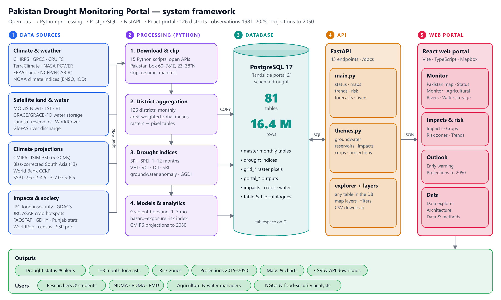

<div align="center">

# 🌵 Pakistan Drought Monitoring Portal

**Monitoring, early warning and climate outlook for meteorological, agricultural and hydrological drought across Pakistan's 126 districts.**


</div>

---

## About

The portal brings 25+ years of satellite, reanalysis and statistical data (monthly from **2000**) into one place to answer three questions:

| | Question | Where in the portal |
|---|---|---|
| 🔎 **Monitor** | Where is there drought right now, and how severe is it? | Drought status, indicator maps, rivers, water storage |
| ⚠️ **Impacts & risk** | Who is affected, and which districts are most at risk? | Food insecurity (IPC), crop hotspots, risk zones |
| 🔮 **Outlook** | What happens next month, and by 2040–2100? | AI early warning (1–3 months), CMIP6 climate projections |

**Data in numbers:** 126 districts · 81 database tables · ~16 million rows · 2000 onwards.

## Architecture



```
frontend (React + Vite)  ──/api/*──▶  backend (FastAPI)  ──SQL──▶  PostgreSQL (schema "drought")
   src/pages/*.tsx                     app/main.py       core drought pages
   src/api.ts                          app/themes.py     water, impacts, crops, population, projections
   src/components/MapView.tsx          app/layers.py     map layers for any district table
                                       app/explorer.py   browse / filter / download any table
                                       app/db.py         database connection (.env)
```

In production, FastAPI also serves the built React app, so the whole portal runs on **one port (8050)**.

## Features

| Page | What it shows |
|---|---|
| **Home** | Live headline numbers: districts in drought, national SPEI-3, GRACE water storage, Tarbela, IPC, database size |
| **Pakistan map** | Any numeric column of any district table as a 3D map with province borders, time slider and animation |
| **Drought status** | Combined drought class per district for any month, with national SPEI-3 / VHI / GRACE |
| **Drought monitor** | Meteorological, hydrological and climate indicators (SPI, SPEI, PDSI, rainfall …) by month |
| **Agricultural** | VHI, VCI, TCI, NDVI, land surface temperature, fAPAR, soil moisture |
| **Rivers** | 15 GloFAS river sites: discharge, % of normal, SRI-3 / SRI-6 |
| **Water storage** | GRACE groundwater and total water storage anomalies; Landsat area of 6 reservoirs |
| **Impacts** | IPC food insecurity, JRC ASAP crop hotspots, GDACS drought alerts |
| **Crops** | GDHY yield anomalies, Punjab wheat statistics, FAOSTAT national crops |
| **Trends** | Share of Pakistan and each province in drought per year; historical drought events |
| **Risk zones** | Hazard × exposure × vulnerability risk map with a full district ranking |
| **Early warning** | Gradient-boosting forecasts of SPEI-3 and VHI 1–3 months ahead, with independent test skill |
| **Projections** | ISIMIP3b district change maps (5 models, SSP1-2.6 / 3-7.0 / 5-8.5 to 2040); World Bank CCKP to 2100 |
| **Data explorer** | Every table in the database: search, filter, sort, page and download as CSV |
| **Data & methods** | Sources, drought classes, methods and limitations |

### Drought risk method

```
risk = 0.5 × hazard + 0.25 × exposure + 0.25 × vulnerability     (each scaled 0–1, classes = quartiles)

hazard         frequency / severity of SPEI-3 ≤ −1 and VHI ≤ 0.4, agricultural drought risk, GRACE decline
exposure       cropland share, population density
vulnerability  water deficit, low rainfall
```

### Early-warning model

`HistGradientBoostingRegressor` per target (SPEI-3, VHI) and lead time (1, 2, 3 months), using drought indices, soil moisture, vegetation, temperature anomalies and climate drivers (ENSO, IOD, PDO …). Trained on 2000–2018, formulation chosen on 2019–2021, and skill reported on **2022–2025, which the model never saw**, against persistence and climatology baselines.

> Forecasts always start from the **latest month in the database**. Refresh the data (see below) to keep them pointing at the coming months.

## Data sources

CHIRPS · TerraClimate · ERA5 / NASA POWER · MODIS (NDVI, LST) · NOAA VHI · Copernicus GDO · GRACE / GRACE-FO · GloFAS · CPC soil moisture · IPC · JRC ASAP · GDACS · GDHY · FAOSTAT · WorldPop · ISIMIP3b (CMIP6) · World Bank CCKP

## Getting started

### Requirements

- **PostgreSQL 17** with the drought data loaded into schema `drought`
- **Python 3.10+**
- **Node.js 18+**
- A free **Mapbox** public token (for the maps)

### 1. Configure

```bash
cp backend/.env.example backend/.env              # add your PostgreSQL password
cp frontend/.env.example frontend/.env.local      # add your Mapbox token
```

### 2. Run

**Windows, one click:** double-click **`start_portal.bat`**. It checks the database, builds the web app on first run, installs the Python packages, starts the server and opens your browser.

**Any OS, manually:**

```bash
cd frontend
npm install
npm run build                 # writes frontend/dist, served by FastAPI

cd ../backend
pip install -r requirements.txt
python -m uvicorn app.main:app --host 0.0.0.0 --port 8050
```

Open **http://localhost:8050**. The API docs are at http://localhost:8050/docs.
Other devices on your network can use `http://<your-PC-IP>:8050`.

### Develop the frontend

```bash
cd frontend
npm run dev                   # http://localhost:5173, proxies /api to :8050
```

## Updating the data

1. Download the latest data and rebuild the master tables (the data pipeline lives outside this repo).
2. Rebuild the portal data, risk zones and AI forecasts:
   ```bash
   cd backend && python prepare.py        # writes backend/data/
   ```
3. Load everything into PostgreSQL (`load_to_postgres.py`).
4. Restart the server; some summaries are cached in memory.

## API overview

| Group | Endpoints |
|---|---|
| Core | `/api/meta`, `/api/geo/districts`, `/api/map`, `/api/status`, `/api/trends`, `/api/health` |
| Time series | `/api/timeseries/district/{id}`, `/api/timeseries/region` |
| Risk & warning | `/api/risk`, `/api/forecast?target=spei_3\|vhi`, `/api/forecast/skill` |
| Water | `/api/rivers`, `/api/groundwater/*`, `/api/reservoirs` |
| Impacts & crops | `/api/impacts/ipc`, `/api/impacts/asap`, `/api/impacts/gdacs`, `/api/crops/*` |
| Projections | `/api/projections/{meta,map,national,district/{id}}` |
| Map layers | `/api/layers`, `/api/layers/{times,values,series}`, `/api/districts/{id}/profile` |
| Any table | `/api/catalog`, `/api/data/{table}`, `/api/data/{table}/csv` |

Filters on `/api/data/{table}`: `?filter=column:op:value` with `eq, ne, gt, gte, lt, lte, like`, plus `order`, `desc`, `limit`, `offset`, `columns`.

## Project structure

```
├── backend/
│   ├── app/              FastAPI application (main, themes, layers, explorer, db)
│   ├── data/             prepared portal data (parquet / geojson), built by prepare.py
│   ├── prepare.py        builds portal data, risk zones and AI forecasts
│   ├── requirements.txt
│   └── .env.example
├── frontend/
│   ├── src/              React pages, components, API client, theme
│   ├── scripts/          framework diagram renderer
│   └── .env.example
├── docs/                 framework diagram (PNG / SVG)
└── start_portal.bat      one-click start on Windows
```

## Author

**Mahnoor Haider** · [@mahnoor114](https://github.com/mahnoor114)
